# MeshDefense: Mission-Critical DevSecOps Platform for Air-Gapped & IL6 Enclaves

[](https://csrc.nist.gov/publications/detail/sp/800-53/rev-5/final)
[](https://csrc.nist.gov/publications/detail/sp/800-53/rev-5/final)
[](https://dodcio.defense.gov/Portals/0/Documents/Library/DoD-ZT-Ref-Arch.pdf)
[](docs/cato/CATO_ARCHITECTURE.md)

**MeshDefense** is an automated, turnkey DevSecOps and Kubernetes governance platform purpose-built for deploying, securing, and operating Platform One's **Big Bang** stack inside disconnected, classified, and air-gapped defense enclaves (DoD Impact Level 5/6, Secret AWS GovCloud, and Top-Secret ISOB regions).

---

## 📌 Executive Summary

Modern defense missions face a critical paradox: operational software velocity must match commercial speed, yet national security enclaves require absolute network isolation and stringent compliance. Traditional military software deployments into isolated enclaves take **9 to 18 months** per environment due to bespoke infrastructure assembly, manual cryptographic key setup, disconnected dependency harvesting, and painstaking ATO paperwork.

**MeshDefense solves this challenge by delivering a pre-engineered, accredited-by-design platform foundation.** It couples immutable Infrastructure as Code (IaC) with automated air-gapped artifact promotion, declarative GitOps reconciliation, and real-time compliance telemetry.

```mermaid
flowchart LR
    subgraph Foundation["1. Isolated Infrastructure"]
        VPC["Multi-AZ Zero-IGW VPC"]
        KMS["Dedicated 6-CMK Keyring"]
        EKS["Private EKS & IRSA"]
    end

    subgraph Security["2. Zero-Trust Core"]
        MESH["Istio STRICT mTLS"]
        ID["Keycloak CAC/PKI SSO"]
        SEC["Vault Raft + KMS Unseal"]
    end

    subgraph Defense["3. Active Cyber Defense & cATO"]
        ACD["NeuVector Protect (eBPF)"]
        POL["Kyverno NIST 800-53"]
        TEL["Vector OCSF Normalizer"]
        OSCAL["Automated OSCAL Exporter"]
    end

    Foundation --> Security --> Defense
```



### Key Differentiators
- **Zero Internet Dependency (Air-Gapped Day-0)**: Built for enclaves with zero Internet Gateways (IGWs). Every image, Helm chart, and credential is pre-seeded via private registries and VPC Interface Endpoints.
- **Continuous Authority to Operate (cATO)**: Rather than point-in-time compliance snapshots, MeshDefense streams live Open Cybersecurity Schema Framework (OCSF v1.1.0) telemetry tagged with NIST SP 800-53 controls and exports machine-readable OSCAL System Security Plans (SSPs) for direct eMASS synchronization.
- **Active Cyber Defense (ACD)**: Beyond passive vulnerability scanning, the platform implements real-time eBPF network filtering and automated process quarantine to isolate rogue execution instantly.
- **Automated Lifecycle & Disaster Recovery**: Features automated upstream Big Bang release diffing, Iron Bank vulnerability triage with automated PR patching (< 14-day MTTR), and 1-click cross-region disaster recovery rehydration.

---

## 💼 Business & Operational Case

### 1. Drastic Reduction in Time-to-Mission (Lead Time: 12 Months ➔ 2 Days)
- **Problem**: Standing up a secure Kubernetes enclave with compliant PKI, service mesh, SIEM integration, and identity federation typically requires teams of defense contractors several months of manual engineering.
- **Solution**: MeshDefense codifies the entire stack into Terraform modules and parameterized Flux v2 GitOps overlays. A fresh, greenfield AWS GovCloud or DoD IL6 ISOB account is operational within hours.

### 2. Radical Cost Savings & Elimination of Manual Retesting
- **Manual Security Reviews**: Conventional accreditation cycles demand hundreds of hours of manual evidence generation and pen-testing before every release.
- **MeshDefense Automation**: Ephemeral pre-flight and post-upgrade smoke test jobs validate mTLS, secret decryption, storage mounts, and network isolation automatically. Automated OSCAL exporters eliminate manual checklist preparation, reducing compliance operating expenses by up to **70%**.

### 3. Preserving cATO Standing via Automated Vulnerability Remediation
- **DoD 14-Day SLA**: Under DoD Continuous ATO guidelines, critical and high vulnerabilities in container workloads must achieve a Mean Time to Remediate (MTTR) under 14 days or risk loss of operational authority.
- **Automated Triage Engine**: MeshDefense monitors tenant images, pulls updated Iron Bank digests, and automatically generates patched GitOps pull requests to maintain permanent compliance without human intervention.

### 4. Robust Mission Assurance (RTO < 60 min, RPO < 12 hr)
- **NIST CP-9 / CP-10 Compliance**: Built-in Velero backup automation targets KMS-encrypted S3 storage and native EBS volume snapshots. Tested restoration drills validate full enclave reconstitution into alternate VPCs and disaster recovery regions in under one hour.

---

## 🏛 Architecture Ecosystem & Multi-Repo Layout

MeshDefense employs a modular, loosely-coupled architecture across specialized workspaces:

```
MeshDefense/
├── meshdefense-clusters/     # Infrastructure as Code (Terraform) for AWS/GovCloud IL6
├── meshdefense-bigbang/      # Mirrored Big Bang Helm Chart, Release Matrices & Offline Harvester
├── meshdefense-apps/         # Mirrored DevSecOps Tooling, Iron Bank Catalog & Values Profiles
├── meshdefense-gitops/       # Declarative Flux v2 GitOps Architecture & Environment Overlays
└── docs/                     # Authoritative Architecture Guides, Runbooks & Compliance Playbooks
```

| Repository / Directory | Purpose | Core Technologies & Controls |
| :--- | :--- | :--- |
| [`meshdefense-clusters`](./meshdefense-clusters) | Provision isolated VPCs, KMS keyrings, private EKS, IRSA, and Day-0 bootstrap ECR registries | Terraform, AWS EKS, KMS Envelope Encryption (SC-12/13), Private VPC Endpoints (SC-7), Bottlerocket / AL2 STIG |
| [`meshdefense-bigbang`](./meshdefense-bigbang) | Automated low-side/high-side artifact harvesting, signature verification, and release diffing | Python 3, Cosign, Iron Bank ECDSA Verification (SI-7), Big Bang Release Diff Validator |
| [`meshdefense-apps`](./meshdefense-apps) | Hardened tenant applications and continuous cATO telemetry tooling | GitLab, SonarQube, NeuVector ACD (SI-4), Kyverno (AC-3/CM-7), Keycloak SSO (IA-2), Vault (SC-12), LGTM Stack, Vector (AU-2) |
| [`meshdefense-gitops`](./meshdefense-gitops) | Automated reconciliation and environment customization | Flux v2, Kustomize, SOPS (SC-13), Istio STRICT mTLS (SC-8/SC-7), Dev/Test/Stg/Prod overlays |
| [`docs`](./docs) | Compliance mapping, cATO telemetry reference, and disaster recovery runbooks | NIST SP 800-53 Rev 5, DoD Cloud SRG IL6, Disaster Recovery SOP (CP-9/10) |

---

## 🛡️ Core Capabilities & Security Controls

### 1. Isolated Infrastructure Baseline
- **Multi-AZ Air-Gapped VPC**: Private subnets only; **zero default Internet Gateways (IGWs)**. All cloud connectivity operates through dedicated AWS VPC Interface and Gateway Endpoints.
- **Dedicated Cryptographic Domains**: 6 isolated customer-managed KMS keys (CMKs) with annual rotation for Network Telemetry, EBS Volumes, S3 Buckets, RDS Databases, Secrets Manager, and Kubernetes Secrets.
- **SSM-Only Jumpbox**: Zero-ingress administrative bastion accessed exclusively via AWS Systems Manager with dual KMS-encrypted logging to S3 and CloudWatch.

### 2. Zero-Trust Mesh & Identity Core
- **Strict Mutual TLS**: Mesh-wide Istio mTLS enforced across all namespaces with outbound traffic locked to `REGISTRY_ONLY`.
- **High-Availability Vault**: Multi-replica Raft consensus engine with native AWS KMS auto-unseal via private VPC endpoints.
- **Defense Identity Federation**: Keycloak single sign-on configured with DoD CAC/PKI client certificate authentication and FIDO2/WebAuthn.
- **Workload Identity (IRSA)**: Fine-grained AWS IAM roles bound to Kubernetes ServiceAccounts via OIDC WebIdentity (eliminating static cloud credentials).

### 3. Continuous Authorization (cATO) & Active Defense
- **Kyverno Admission Governance**: Strict enforcement of Pod Security Standards, Linux capability drops, non-root execution, and Iron Bank Cosign cryptographic signature verification.
- **NeuVector Active Cyber Defense**: Real-time behavioral packet inspection via eBPF kernel drivers, with automated quarantine of suspicious processes and network connections.
- **LGTM Telemetry Engine**: Loki (S3 storage persistence), Prometheus (OMB M-21-31 90-day retention), Tempo (distributed tracing), and Grafana.
- **Automated OSCAL Compliance**: Generates NIST SP 800-53 Rev 5 System Security Plans and Assessment Results formatted in JSON for automated eMASS compliance ingestion.

### 4. Lifecycle Automation & Disaster Recovery
- **Upstream Release Diff Engine**: Inspects upstream Big Bang Helm chart updates, extracts structural breaking changes, and flags deprecations before deployment.
- **Automated Smoke Test Suite**: Executes ephemeral in-cluster Jobs verifying cross-service mTLS, ingress routing, secret decryption, and storage mounts.
- **Automated Iron Bank CVE Patching**: Continually queries registry digests, alerts on SLA breaches (> 14 days), and automatically cuts Git pull requests with bumped digests.
- **Resilient Disaster Recovery**: Automated Velero backups and scripted cross-region enclave rehydration drills meeting strict DoD RPO/RTO requirements.

---

## 🚀 Quickstart & Operational Commands

### 1. Deploy Cloud Infrastructure (Terraform)
```bash
cd meshdefense-clusters/environments/poc-cloud-minimal
terraform init
terraform apply -auto-approve
```

### 2. Deploy Platform Security Controls
```bash
# 1. External Secrets Operator (AWS Secrets Manager Sync)
bash meshdefense-clusters/scripts/deploy-external-secrets.sh

# 2. HashiCorp Vault (HA Raft with AWS KMS Auto-Unseal)
bash meshdefense-clusters/scripts/deploy-vault-kms-raft.sh

# 3. Istio Zero-Trust Service Mesh (STRICT mTLS)
bash meshdefense-clusters/scripts/deploy-istio-zero-trust.sh

# 4. Kyverno NIST 800-53 Admission Controls & Cosign Verification
bash meshdefense-clusters/scripts/deploy-kyverno-policy-pack.sh

# 5. NeuVector Active Cyber Defense (Protect Mode)
bash meshdefense-clusters/scripts/deploy-neuvector-acd.sh

# 6. Velero Backup & Disaster Recovery Automation
bash meshdefense-clusters/scripts/deploy-velero-dr.sh
```

### 3. Operational Lifecycle & Compliance Verification
```bash
# Run Pre-Flight / Post-Upgrade Integration Smoke Tests
bash meshdefense-clusters/scripts/run-smoke-tests.sh post-upgrade

# Run Iron Bank CVE Triage & MTTR Compliance Scan (< 14 Days SLA)
python3 meshdefense-clusters/scripts/ironbank-cve-triage.py

# Automatically Apply Available Iron Bank Image Patches to GitOps
python3 meshdefense-clusters/scripts/ironbank-cve-triage.py --apply-patch

# Run Upstream Big Bang Release Diff & Deprecation Analysis
python3 meshdefense-bigbang/scripts/upstream-diff-validator.py \
  --current meshdefense-bigbang/versions/release-matrix.yaml \
  --target-version 3.32.0

# Execute Automated Disaster Recovery Rehydration Drill (NIST CP-9 / CP-10)
bash meshdefense-clusters/scripts/dr-restore-drill.sh
```

---

## 📜 Compliance & Security Control Mapping

MeshDefense is mapped directly against **NIST SP 800-53 Rev 5** and **DoD Cloud Computing SRG IL6**:

| Control | Description | MeshDefense Implementation |
| :--- | :--- | :--- |
| **AC-3 / CM-7** | Access Enforcement & Least Functionality | Kyverno admission controller enforcing non-root execution, dropping Linux capabilities, and blocking host mounts |
| **SI-4** | Information System Monitoring | NeuVector ACD DaemonSet in Protect mode with real-time process quarantine & syslog event forwarding |
| **SI-7** | Software & Information Integrity | Cryptographic Cosign signature verification on all admitted container images from Iron Bank |
| **SC-7** | Boundary Protection | Multi-AZ isolated VPC with zero IGWs; Istio STRICT mTLS with egress BlackHole filtering |
| **SC-12 / SC-13** | Cryptographic Key Management | 6 dedicated customer-managed KMS keys (CMKs) with automated rotation; FIPS 140-3 envelope encryption |
| **IA-2** | Identification and Authentication | Keycloak DoD SSO integrating PKI/CAC client certificates and FIDO2/WebAuthn |
| **AU-2 / AU-6** | Audit Record Generation & Review | Vector normalizer forwarding OCSF v1.1.0 JSON logs with NIST Control tags to S3-backed Loki |
| **CP-9 / CP-10** | Contingency Planning & Recovery | Velero automated S3/KMS backups and automated cross-region rehydration drills with verified RTO/RPO |
| **CA-7** | Continuous Monitoring (cATO) | Automated OSCAL SSP/Assessment Results exporter and executive cATO Grafana dashboard |

---

## 📚 Technical References & Deep Dives

- **Continuous Authorization**: [cATO Architecture & Active Cyber Defense](docs/cato/CATO_ARCHITECTURE.md)
- **Disaster Recovery**: [Disaster Recovery Playbook & Rehydration SOP](docs/disaster-recovery/DISASTER_RECOVERY_PLAYBOOK.md)
- **Local Enclave Testing**: [Local POC Deployment Guide (Kind & OrbStack)](docs/local-poc-guide.md)
- **Infrastructure Code**: [meshdefense-clusters Documentation](meshdefense-clusters/README.md)
- **Big Bang Packaging**: [meshdefense-bigbang Documentation](meshdefense-bigbang/README.md)
- **Tenant Applications**: [meshdefense-apps Documentation](meshdefense-apps/README.md)
- **GitOps Engine**: [meshdefense-gitops Documentation](meshdefense-gitops/README.md)
