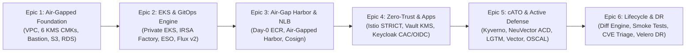

# MeshDefense: Air-Gapped DevSecOps Kubernetes Platform for Big Bang

[](https://csrc.nist.gov/publications/detail/sp/800-53/rev-5/final)
[](https://csrc.nist.gov/publications/detail/sp/800-53/rev-5/final)
[](https://dodcio.defense.gov/Portals/0/Documents/Library/DoD-ZT-Ref-Arch.pdf)
[](docs/cato/CATO_ARCHITECTURE.md)

Welcome to **MeshDefense**, an enterprise-grade, turn-key platform designed for deploying, hardening, and operating Platform One's **Big Bang** DevSecOps suite inside disconnected, air-gapped DoD Impact Level 6 (IL6), Secret, and Top-Secret cloud enclaves.

---

## 🏛 Architecture Ecosystem & Multi-Repo Layout

MeshDefense is structured across decoupled repositories and packages:

```
MeshDefense/
├── meshdefense-clusters/     # Infrastructure as Code (Terraform) for AWS/GovCloud IL6
├── meshdefense-bigbang/      # Mirrored Big Bang Helm Chart, Release Matrices & Offline Harvester
├── meshdefense-apps/         # Mirrored DevSecOps Tooling, Iron Bank Catalog & Values Profiles
├── meshdefense-gitops/       # Declarative Flux v2 GitOps Architecture & Environment Overlays
└── docs/                     # Authoritative Architecture Guides, Runbooks & Compliance Playbooks
```

| Repository / Directory | Purpose | Core Technologies & Controls |
| :--- | :--- | :--- |
| [`meshdefense-clusters`](./meshdefense-clusters) | Provision isolated VPCs, KMS keyrings, private EKS, IRSA, and Day-0 bootstrap ECR registries | Terraform, AWS EKS, KMS Envelope Encryption (SC-12/13), Private VPC Endpoints (SC-7), Bottlerocket / AL2 STIG |
| [`meshdefense-bigbang`](./meshdefense-bigbang) | Automated low-side/high-side artifact harvesting, signature verification, and release diffing | Python 3, Cosign, Iron Bank ECDSA Verification (SI-7), Big Bang 2.x/3.x Diff Validator |
| [`meshdefense-apps`](./meshdefense-apps) | Hardened tenant applications and continuous cATO telemetry tooling | GitLab, SonarQube, NeuVector ACD (SI-4), Kyverno (AC-3/CM-7), Keycloak SSO (IA-2), Vault (SC-12), LGTM Stack, Vector (AU-2) |
| [`meshdefense-gitops`](./meshdefense-gitops) | Automated reconciliation and environment customization | Flux v2, Kustomize, SOPS (SC-13), Istio STRICT mTLS (SC-8/SC-7), Dev/Test/Stg/Prod overlays |
| [`docs`](./docs) | Compliance mapping, cATO telemetry reference, and disaster recovery runbooks | NIST SP 800-53 Rev 5, DoD Cloud SRG IL6, Disaster Recovery SOP (CP-9/10) |

---

## 🔒 Implemented Capabilities & Epics Summary

MeshDefense implements six major capability epics covering Day-0 through Day-2 operations:



### Epic 1: Air-Gapped Enclave Infrastructure Baseline
- **Isolated Multi-AZ VPC**: Private subnets only; **zero default Internet Gateways (IGWs)**.
- **Dedicated Cryptographic Keyring**: 6 distinct customer-managed KMS keys (CMKs) providing strict domain isolation for Network, EBS, S3, RDS, Secrets Manager, and Kubernetes Secrets.
- **SSM-Only Bastion**: Zero-ingress jumpbox managed exclusively via AWS Systems Manager with dual S3/CloudWatch audit logging.
- **Air-Gapped S3 & RDS**: Buckets enforce TLS 1.2+ and SSE-KMS; RDS PostgreSQL Multi-AZ enforces encrypted storage and IAM authentication.

### Epic 2: EKS Control Plane, Workload Identity & GitOps Bootstrap
- **Private EKS Control Plane**: API server reachable strictly through private VPC endpoints; control plane audit logging enabled.
- **Granular IRSA Factory**: Automated least-privilege IAM roles mapped to Kubernetes ServiceAccounts via OIDC WebIdentity federation (no static IAM credentials).
- **External Secrets Operator (ESO)**: Native synchronization from AWS Secrets Manager using KMS envelope decryption.
- **Flux v2 Air-Gapped GitOps**: Automated controller reconciliation pulling strictly from internal registries.

### Epic 3: Container Registry & Air-Gapped Ingress
- **Day-0 Seed Registry**: Pre-seeded private AWS ECR repositories for bootstrap controllers (Flux, CoreDNS, VPC CNI, Harbor).
- **Hardened In-Cluster Harbor**: S3/KMS object storage backend, Keycloak OIDC authentication, and Kyverno Cosign image signature verification.
- **Air-Gapped AWS Load Balancer Controller**: Internal Network Load Balancers (NLB) with TLS termination and Cross-Zone balancing.

### Epic 4: Zero-Trust Service Mesh & Enterprise Core
- **Istio Service Mesh in STRICT Mode**: Mutual TLS (`STRICT`) enforced across all namespaces with egress lockdown (`REGISTRY_ONLY`).
- **HashiCorp Vault High-Availability**: Raft storage backend with automated AWS KMS unsealing.
- **Keycloak DoD SSO**: CAC/PKI client certificate authentication and FIDO2/WebAuthn MFA support.
- **DevSecOps Applications**: Hardened profiles for GitLab Enterprise, GitLab Runner, and SonarQube with dedicated tenant IRSA roles.

### Epic 5: Continuous Authorization (cATO) & Active Cyber Defense
- **Kyverno NIST 800-53 Policy Pack**: Enforces non-root execution, drops Linux capabilities, blocks host namespaces, and validates Iron Bank Cosign signatures with JSON audit streams.
- **NeuVector Active Cyber Defense (ACD)**: DaemonSet deployed in `Protect` mode with behavioral network inspection and real-time process quarantine.
- **LGTM Observability Stack**: Loki with S3 object storage persistence, Prometheus with OMB M-21-31 retention (90d/40GB), Tempo distributed tracing, and Grafana.
- **Vector Telemetry Normalizer**: OCSF v1.1.0 JSON normalization enriched with NIST SP 800-53 Control IDs (`AC-3`, `CM-7`, `SI-4`, `SI-7`, `SC-7`, `SC-12`, `IA-2`, `AU-2`).
- **Executive cATO Dashboard**: Real-time drilldowns into policy violation rates, blocked egress, quarantined processes, and CVE MTTR.
- **Automated OSCAL Exporter**: Scheduled pipeline producing NIST SP 800-53 Rev 5 System Security Plans (SSP) and Assessment Results for direct eMASS ingestion.

### Epic 6: Upstream Lifecycle Management, Iron Bank Patching & Disaster Recovery
- **Upstream Release Diff Utility** (`upstream-diff-validator.py`): Compares Big Bang releases, parses structural changes, and identifies breaking dependencies.
- **Automated Pre-Flight & Post-Upgrade Smoke Test Suite** (`run-smoke-tests.sh`): Ephemeral Kubernetes Jobs validating mTLS, ingress routing, secret decryption, storage mounts, and admission gates.
- **Iron Bank CVE Triage & Auto-Patching** (`ironbank-cve-triage.py`): Scans tenant images, tracks MTTR against the DoD 14-day SLA, applies in-place patches, and creates PR branches.
- **Velero Backup & Disaster Recovery**: AWS plugin with IRSA, private encrypted S3 bucket, EBS native volume snapshots, daily cluster state backups, and weekly CRD archives.
- **Cross-Region DR Replication & Restoration Drills** (`dr-restore-drill.sh`): Documented playbook and automated drill script validating RPO (< 12h) and RTO (< 60m) under NIST CP-9/CP-10.

---

## 🚀 Quickstart & Operational Commands

### 1. Pre-Flight Infrastructure Check
Verify VPC endpoints, KMS keyrings, and IAM boundary permissions:
```bash
bash meshdefense-clusters/scripts/airgap-prereqs.sh
```

### 2. Deploy Cloud Infrastructure (Terraform)
```bash
cd meshdefense-clusters/environments/poc-cloud-minimal
terraform init
terraform apply -auto-approve
```

### 3. Deploy Platform Components & Security Controls
```bash
# 1. External Secrets Operator
bash meshdefense-clusters/scripts/deploy-external-secrets.sh

# 2. Vault with AWS KMS Auto-Unseal
bash meshdefense-clusters/scripts/deploy-vault-kms-raft.sh

# 3. Istio Zero-Trust Service Mesh
bash meshdefense-clusters/scripts/deploy-istio-zero-trust.sh

# 4. Kyverno NIST 800-53 Admission Controls
bash meshdefense-clusters/scripts/deploy-kyverno-policy-pack.sh

# 5. NeuVector Active Cyber Defense (Protect Mode)
bash meshdefense-clusters/scripts/deploy-neuvector-acd.sh

# 6. Velero Backup & Disaster Recovery
bash meshdefense-clusters/scripts/deploy-velero-dr.sh
```

### 4. Continuous Lifecycle, Compliance & Smoke Tests
```bash
# Execute Pre-Flight / Post-Upgrade Integration Smoke Tests
bash meshdefense-clusters/scripts/run-smoke-tests.sh post-upgrade

# Run Iron Bank CVE Triage & MTTR Compliance Scan (< 14 Days SLA)
python3 meshdefense-clusters/scripts/ironbank-cve-triage.py

# Automatically apply available Iron Bank patches across tenant values
python3 meshdefense-clusters/scripts/ironbank-cve-triage.py --apply-patch

# Run Upstream Big Bang Release Diff & Deprecation Analysis
python3 meshdefense-bigbang/scripts/upstream-diff-validator.py \
  --current meshdefense-bigbang/versions/release-matrix.yaml \
  --target-version 3.32.0

# Execute Automated Disaster Recovery Rehydration Drill (NIST CP-9 / CP-10)
bash meshdefense-clusters/scripts/dr-restore-drill.sh
```

---

## 📚 Documentation & Technical References

- **Disaster Recovery**: [Disaster Recovery Playbook (SOP & Architecture)](docs/disaster-recovery/DISASTER_RECOVERY_PLAYBOOK.md)
- **Local Testing**: [Local POC Deployment Guide (Kind & OrbStack)](docs/local-poc-guide.md)
- **Clusters & Cloud IaC**: [meshdefense-clusters Documentation](meshdefense-clusters/README.md)
- **Big Bang Packaging**: [meshdefense-bigbang Documentation](meshdefense-bigbang/README.md)
- **Tenant Applications**: [meshdefense-apps Documentation](meshdefense-apps/README.md)
- **GitOps Engine**: [meshdefense-gitops Documentation](meshdefense-gitops/README.md)

---

## 📜 Compliance & Security Control Mapping
MeshDefense is explicitly mapped against **NIST SP 800-53 Rev 5** and **DoD Cloud Computing SRG IL6**:

| Control | Description | MeshDefense Implementation |
| :--- | :--- | :--- |
| **AC-3 / CM-7** | Access Enforcement & Least Functionality | Kyverno admission controller blocking non-root, privilege escalation, and unauthorized host mounts |
| **SI-4** | Information System Monitoring | NeuVector ACD DaemonSet in Protect mode with real-time process quarantine & syslog streaming |
| **SI-7** | Software, Firmware, and Information Integrity | Cosign cryptographic signature verification on all admitted container images from Iron Bank |
| **SC-7** | Boundary Protection | Multi-AZ isolated VPC with zero IGWs; Istio STRICT mTLS with egress BlackHole filtering |
| **SC-12 / SC-13** | Cryptographic Protection & Key Management | 6 dedicated customer managed KMS keys (CMKs) with annual rotation; FIPS 140-3 envelope encryption |
| **IA-2** | Identification and Authentication | Keycloak DoD SSO integrating PKI/CAC client certificates and FIDO2/WebAuthn |
| **AU-2 / AU-6** | Audit Record Generation & Review | Vector normalizer forwarding OCSF v1.1.0 JSON logs with NIST Control tags to S3-backed Loki |
| **CP-9 / CP-10** | Contingency Planning, Backup & Recovery | Velero automated S3/KMS backups and automated cross-region rehydration drill with verified RTO/RPO |
| **CA-7** | Continuous Monitoring (cATO) | Automated OSCAL SSP/Assessment Results exporter and executive cATO Grafana dashboard |
