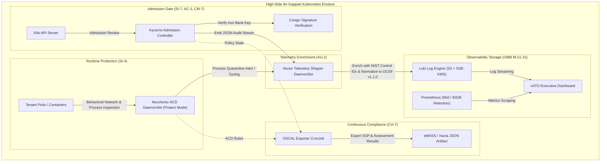

# Continuous Authorization to Operate (cATO) Architecture

## 1. Overview & Objective
In high-security DoD Impact Level 6 (IL6) and national security enclaves, traditional point-in-time security authorizations (often re-evaluated every 1-3 years) are insufficient to address modern containerized threat landscapes. 

**MeshDefense** implements an active **Continuous Authorization to Operate (cATO)** architecture grounded in:
1. **Continuous Telemetry & Observability**: Granular log and metric capture aligned with OMB M-21-31.
2. **Active Cyber Defense (ACD)**: Real-time container behavioral analysis and process quarantine.
3. **Automated Admission Control & Policy Streaming**: Cryptographic provenance and privilege blocking.
4. **Machine-Readable Compliance Export**: Direct eMASS ingestion via the Open Security Controls Assessment Language (OSCAL).

---

## 2. cATO Telemetry & Defense Pipeline

---

## 3. Core Architecture Pillars

### Pillar 1: Kyverno NIST 800-53 Policy Pack (Story 5.1)
- **Controls Enforced**: `AC-3` (Access Enforcement), `CM-7` (Least Functionality), `SI-7` (Software Integrity).
- **Hardening Rules**:
  - `block-non-root-execution`: Denies pods running as UID 0.
  - `block-privilege-escalation`: Denies `allowPrivilegeEscalation: true`.
  - `block-host-namespaces`: Prohibits sharing `hostPID`, `hostIPC`, or `hostNetwork`.
  - `verify-iron-bank-cosign-signatures`: Rejects container images lacking valid Cosign ECDSA signatures from Iron Bank.
- **Audit Streaming**: Admission decisions are emitted as structured JSON audit events to Vector.

### Pillar 2: NeuVector Active Cyber Defense (Story 5.2)
- **Controls Enforced**: `SI-4` (Information System Monitoring).
- **Execution Mode**: `Protect` mode across all worker nodes.
- **Dynamic Capabilities**:
  - Automatically learns benign network communication graphs (Layer 7 DPI).
  - Actively blocks unauthorized lateral movement attempts.
  - Terminates and quarantines processes executing outside baseline container image profiles.

### Pillar 3: LGTM Observability Stack (Story 5.3)
- **Controls Enforced**: `AU-2` (Event Logging), `AU-6` (Audit Record Review), OMB M-21-31.
- **Persistent Storage**: Loki persists compressed chunks directly to S3 with SSE-KMS encryption.
- **Retention Standards**: Prometheus enforces 90-day retention and 40GB local volume quotas with WAL compression.

### Pillar 4: Vector OCSF Telemetry Normalization (Story 5.4)
- **Controls Enforced**: `AU-2`, `AU-3`, `AU-12`.
- **Normalization Standard**: Normalizes heterogeneous log formats into **Open Cybersecurity Schema Framework (OCSF v1.1.0)** JSON.
- **Automated Enrichment**: Maps container and event metadata to specific NIST SP 800-53 Rev 5 control identifiers (`SC-7`, `SC-12`, `IA-2`, `AC-3`, `CM-7`, `SI-4`, `SI-7`, `AU-2`).

### Pillar 5: Real-Time Executive cATO Dashboard (Story 5.5)
- **Visual Compliance Engine**: Deployed into Grafana, providing authorizing officials (AOs) with live insight into:
  - Policy enforcement and failure rates.
  - Active cyber defense interventions (processes quarantined, connections blocked).
  - Cosign signature verification status.
  - Vulnerability Mean Time to Remediate (MTTR) against DoD 14-day SLA.

### Pillar 6: Automated OSCAL Exporter (Story 5.6)
- **Controls Enforced**: `CA-7` (Continuous Monitoring).
- **Machine-Readable Artifacts**: Scheduled CronJob evaluates cluster state and outputs:
  - Standardized **System Security Plan (SSP)**.
  - Standardized **Assessment Results** (SAR).
- **Zero-Manual eMASS Ingestion**: Generates valid OSCAL JSON consumable by eMASS, Xacta, and NIST OSCAL CLI tools.
