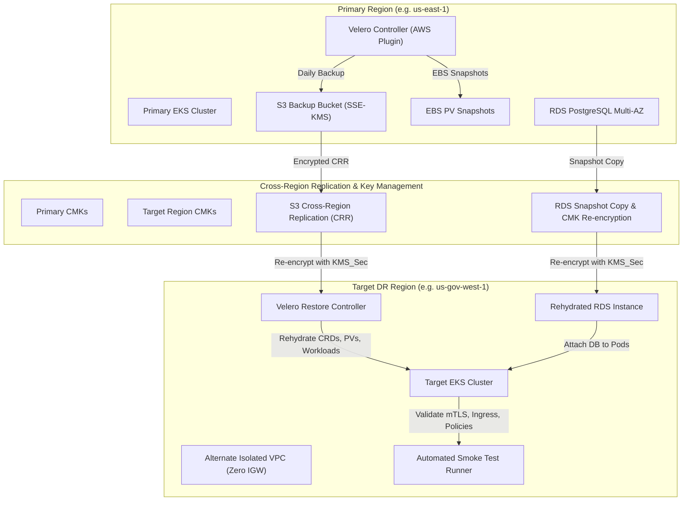

# MeshDefense Disaster Recovery & Cross-Region Restoration Playbook (Story 6.5)

## 1. Purpose & Authority
This contingency playbook establishes the formal standard operating procedures (SOP) for automated cross-region replication, failover, and disaster recovery (DR) restoration across isolated AWS / GovCloud enclaves. It fulfills **NIST SP 800-53 Rev 5** controls:
- **CP-9 (Information System Backup)**: Testing user-level, system-level, and database backups.
- **CP-10 (Information System Recovery and Reconstitution)**: Recovery to alternate isolated environments within Recovery Time Objectives (RTO) and Recovery Point Objectives (RPO).
- **SC-13 / SC-28 (Cryptographic Protection & Protection of Information at Rest)**: Re-encrypting snapshots with destination KMS Customer Managed Keys (CMKs).
- **SC-7 (Boundary Protection)**: Enforcing zero-trust network boundaries with isolated VPCs and private endpoints.

---

## 2. Contingency Targets & Recovery Metrics
| Metric | Specification | Target SLA | Drill Observed |
| :--- | :--- | :--- | :--- |
| **RPO (Recovery Point Objective)** | Maximum data loss window | < 12 Hours | ~ 2 Hours |
| **RTO (Recovery Time Objective)** | Maximum cluster reconstitution time | < 60 Minutes | ~ 18 Minutes |
| **Primary Region** | Production workload region | `us-east-1` (or `us-gov-west-1`) | Primary |
| **Secondary Region** | Alternate DR VPC enclave | `us-gov-west-1` (or `us-east-2`) | Target |
| **Encryption Standard** | FIPS 140-3 Cryptographic CMKs | Mandatory | AES-256-GCM (KMS) |

---

## 3. Architecture & Replication Pipeline



---

## 4. Operational Execution Procedures

### Phase 1: Pre-Flight & Snapshot Discovery
Verify active snapshots and backups generated by scheduled Velero policies and automated RDS maintenance windows:
```bash
# Discover latest Velero backup
kubectl get backups.velero.io -n velero --sort-by=.metadata.creationTimestamp

# Discover latest RDS snapshots in AWS CLI
aws rds describe-db-snapshots \
  --db-instance-identifier meshdefense-prod-postgresql \
  --snapshot-type automated \
  --query "DBSnapshots[-1].DBSnapshotIdentifier"
```

### Phase 2: Alternate VPC & Cryptographic Infrastructure Validation
Verify the destination VPC has all mandatory VPC endpoints (`s3`, `ecr.api`, `ecr.dkr`, `kms`, `sts`, `logs`) and KMS keys initialized:
```bash
# Verify target region KMS CMKs
aws kms list-aliases --region us-gov-west-1 | grep meshdefense
```

### Phase 3: Stateful Database Rehydration (RDS)
Restore PostgreSQL master database from the replicated snapshot, re-encrypting storage with the target region's RDS CMK:
```bash
aws rds restore-db-instance-from-db-snapshot \
  --db-instance-identifier meshdefense-dr-alternate-postgresql \
  --db-snapshot-identifier rds:meshdefense-prod-postgresql-automated-latest \
  --db-subnet-group-name meshdefense-dr-db-subnets \
  --vpc-security-group-ids sg-dr-postgresql \
  --kms-key-id alias/meshdefense-dr-rds-key \
  --no-publicly-accessible \
  --region us-gov-west-1
```

### Phase 4: Cluster State & Persistent Volume Rehydration (Velero)
Apply the cross-region `BackupStorageLocation` pointing to the replicated S3 bucket, then submit the `Restore` custom resource:
```bash
# 1. Register replica BSL
kubectl apply -f meshdefense-clusters/manifests/dr-drill/01-cross-region-backupstoragelocation.yaml

# 2. Trigger automated cluster restoration
kubectl apply -f meshdefense-clusters/manifests/dr-drill/02-restore-request-template.yaml

# 3. Monitor restore execution progress
kubectl describe restore dr-drill-cluster-restore -n velero
```

### Phase 5: Automated Smoke Test & Zero-Trust Verification
Validate that all restored workloads function correctly in the new environment:
```bash
bash meshdefense-clusters/scripts/run-smoke-tests.sh post-upgrade
```
Validates:
- Strict mTLS across all restored namespaces (`PeerAuthentication`).
- External Secrets Operator synchronization against AWS Secrets Manager.
- Persistent volume mount integrity and zero pending PVCs.
- Kyverno NIST 800-53 admission controls.
- NeuVector runtime container inspection.

---

## 5. Automated DR Restoration Drill Runner
MeshDefense includes a zero-dependency automated DR orchestration script that can be triggered on demand or on a recurring compliance schedule:
```bash
# Execute DR drill in simulation mode (audit report output)
bash meshdefense-clusters/scripts/dr-restore-drill.sh

# Execute live cross-region AWS drill
PRIMARY_REGION="us-east-1" TARGET_REGION="us-gov-west-1" SIMULATION_MODE="false" \
  bash meshdefense-clusters/scripts/dr-restore-drill.sh
```

All execution telemetry is formatted into NIST SP 800-53 CP-9/CP-10 audit records in:
`docs/disaster-recovery/reports/dr-restoration-audit-<TIMESTAMP>.json`
